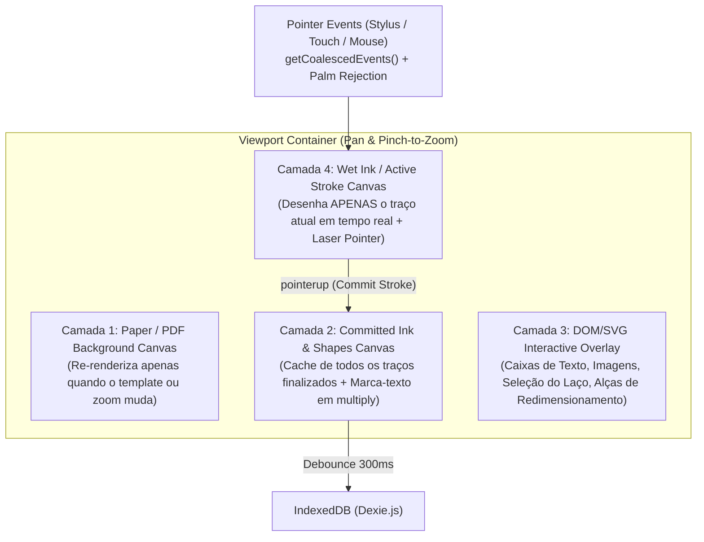

# ARCHITECTURE.md — Arquitetura Técnica, Modelo de Dados e Plano de Fases

## 1. Stack Tecnológica

| Camada | Tecnologia | Justificativa Técnica |
| :--- | :--- | :--- |
| **Framework Web** | **Next.js (App Router) + React + TypeScript** | Renderização cliente rápida (`'use client'` no motor de canvas), tipagem estrita, roteamento limpo e deploy zero-config na Vercel. |
| **Estilização & UI** | **Tailwind CSS + Lucide Icons + SVGs Customizados** | Tokens CSS para Light/Dark mode, `backdrop-blur` nativo estilo iPadOS e responsividade para tablets em retrato/paisagem. |
| **Motor de Traço (Ink Engine)** | **HTML5 Canvas 2D Multi-Layer + `perfect-freehand` + Pointer Events API** | Captura `e.getCoalescedEvents()` para 120Hz/240Hz (Apple Pencil / S-Pen), pressão real (`e.pressure`), inclinação (`tiltX/Y`), rejeição de palma (`pointerType === 'pen'`) e suavização poligonal de baixíssima latência. |
| **Banco de Dados Local** | **IndexedDB via `Dexie.js`** | Armazenamento local assíncrono de alta capacidade (centenas de MBs/GBs para PDFs, imagens e milhares de traços) 100% offline no navegador do tablet. |
| **Motor de PDF (Importação)** | **`pdfjs-dist` (Mozilla PDF.js)** | Renderização fiel de páginas de PDF em canvas offscreen com suporte a alta densidade de pixels (Retina/Super AMOLED) e extração de texto/outline. |
| **Motor de PDF (Exportação)** | **`pdf-lib`** | Geração e modificação de documentos PDF no cliente, mesclando páginas originais de PDF ou templates vetoriais com as camadas de anotação. |
| **PWA / Offline** | **Web App Manifest + Service Worker** | Instalação em tela cheia (`standalone`) no iPadOS / Android Tablet com cache offline de assets. |

---

## 2. Arquitetura do Motor de Canvas Multi-Camadas (Baixa Latência)

Para garantir **60–120fps reais sem engasgos** mesmo em páginas com milhares de traços e PDF de fundo, cada página aberta no editor utiliza **4 camadas sobrepostas** sincronizadas pela mesma matriz de transformação (`scale`, `translateX`, `translateY`):



### Por que essa separação é crítica?
1. Durante o movimento da caneta (`pointermove`), **apenas a Camada 4 (Wet Ink)** é limpa e redesenhada a cada frame — custo $O(1)$ relativo ao número de traços já existentes na página.
2. O **Marca-Texto** é desenhado abaixo dos traços de caneta na Camada 2 com `globalCompositeOperation = 'multiply'` (ou opacidade dedicada), garantindo que grifar por cima de um texto ou traço preto jamais apague ou acinzente a escrita.
3. A **Borracha de Precisão** e o **Laço** utilizam indexação por *Bounding Box* (`minX, minY, maxX, maxY`) em cada traço para teste de colisão instantâneo antes de testar ponto a ponto.

---

## 3. Modelo de Dados (`Dexie.js` / IndexedDB)

```typescript
// 1. Pasta da Biblioteca
export interface FolderRecord {
  id: string;
  name: string;
  parentId: string | null; // null = raiz
  isFavorite: boolean;
  isTrashed: boolean;
  createdAt: number;
  updatedAt: number;
}

// 2. Caderno (Notebook)
export interface NotebookRecord {
  id: string;
  title: string;
  folderId: string | null;
  coverStyle: string;       // ex: 'classic-kraft', 'navy-leather', 'pastel-sage', etc.
  coverColor: string;
  defaultTemplate: PaperTemplateId;
  defaultPaperColor: 'cream' | 'white' | 'dark';
  pageSize: 'goodnotes' | 'a4' | 'a5' | 'letter';
  orientation: 'portrait' | 'landscape';
  isFavorite: boolean;
  isTrashed: boolean;
  pdfAssetId?: string | null; // Caso o caderno tenha sido criado a partir de um PDF
  lastOpenedPageIndex: number;
  createdAt: number;
  updatedAt: number;
}

// 3. Página Individual (Page)
export interface PageRecord {
  id: string;
  notebookId: string;
  pageNumber: number;       // Ordem 0-based
  template: PaperTemplateId;
  paperColor: 'cream' | 'white' | 'dark';
  orientation: 'portrait' | 'landscape';
  rotation: 0 | 90 | 180 | 270;
  isFavorite: boolean;
  pdfPageIndex?: number | null; // Índice 1-based da página no PDF anexado (se houver)
  pdfTextContent?: string;      // Texto extraído do PDF para busca rápida
  strokes: StrokeElement[];     // Traços de caneta e marca-texto
  shapes: ShapeElement[];       // Formas geométricas vetoriais
  textBoxes: TextBoxElement[];  // Caixas de texto ricas
  images: ImageElement[];       // Imagens e stickers colados
  updatedAt: number;
}

// 4. Estruturas de Elementos da Página
export interface StrokePoint {
  x: number;        // Coordenada normalizada na página (base 794x1123)
  y: number;
  pressure: number; // 0.0 a 1.0
  tiltX?: number;
  tiltY?: number;
}

export interface StrokeElement {
  id: string;
  tool: 'pen' | 'highlighter';
  penType: 'fountain' | 'ball' | 'brush';
  color: string;
  size: number;
  opacity: number;
  points: StrokePoint[];
  bbox: { minX: number; minY: number; maxX: number; maxY: number };
}

export interface ShapeElement {
  id: string;
  shapeType: 'line' | 'arrow' | 'rectangle' | 'ellipse' | 'triangle';
  x1: number;
  y1: number;
  x2: number;
  y2: number;
  points?: { x: number; y: number }[];
  strokeColor: string;
  fillColor?: string | null;
  strokeWidth: number;
  rotation: number;
}

export interface TextBoxElement {
  id: string;
  x: number;
  y: number;
  width: number;
  height: number;
  text: string;
  fontFamily: 'sans' | 'serif' | 'mono' | 'handwritten';
  fontSize: number;
  color: string;
  backgroundColor: string;
  borderColor: string;
  textAlign: 'left' | 'center' | 'right';
  bold: boolean;
  italic: boolean;
  rotation: number;
}

export interface ImageElement {
  id: string;
  assetId: string; // Referência na tabela de blobs ou dataURL otimizado
  x: number;
  y: number;
  width: number;
  height: number;
  rotation: number;
  crop?: { x: number; y: number; width: number; height: number };
}

// 5. Tabela de Blobs Binários (PDFs e Imagens de Alta Resolução)
export interface AssetBlobRecord {
  id: string;
  mimeType: string;
  name: string;
  data: ArrayBuffer | Blob | string;
  createdAt: number;
}
```

---

## 4. Estrutura de Pastas do Projeto

O aplicativo será estruturado de forma modular e limpa (por exemplo, em `C:\Users\nardu\goodnotes-web` ou onde você preferir na máquina):

```text
├── docs/
│   ├── FEATURES.md
│   ├── UI-SPEC.md
│   └── ARCHITECTURE.md
├── public/
│   ├── manifest.webmanifest
│   ├── sw.js
│   ├── pdf.worker.min.mjs
│   └── icons/
│       ├── icon-192.png
│       ├── icon-512.png
│       └── apple-touch-icon.png
├── src/
│   ├── app/
│   │   ├── layout.tsx
│   │   ├── page.tsx                 # Ponto de entrada principal (Biblioteca + Abas Abertas)
│   │   └── globals.css              # Design tokens, estilos iPadOS, lock de touch-action
│   ├── components/
│   │   ├── library/
│   │   │   ├── LibraryView.tsx      # Navegação de pastas, favoritos, lixeira, ordenação
│   │   │   ├── NotebookCard.tsx     # Renderizador de capa realista 3:4 e ações rápidas
│   │   │   ├── FolderCard.tsx       # Card de pasta iPadOS
│   │   │   ├── NewNotebookModal.tsx # Seletor de capa, template, cor e orientação
│   │   │   └── MoveItemModal.tsx    # Árvore de pastas para mover itens
│   │   ├── editor/
│   │   │   ├── DocumentWorkspace.tsx# Gerenciador de abas, topbar, zoom/pan e páginas
│   │   │   ├── WritingToolbar.tsx   # Barra estilo GoodNotes com popovers e slots de cor/espessura
│   │   │   ├── PageCanvas.tsx       # Motor de 4 camadas (Papel/PDF, Tinta, Objetos, Wet Ink)
│   │   │   ├── PageThumbnailsModal.tsx # Grid de páginas, reordenação, favoritos e outline
│   │   │   ├── ZoomWindowPanel.tsx  # Janela de escrita ampliada com auto-advance
│   │   │   └── StickersPopover.tsx  # Coleção de elementos/stickers vetoriais
│   │   └── common/
│   │       ├── SearchModal.tsx      # Busca global (títulos, textos e conteúdo de PDF)
│   │       └── ShortcutsModal.tsx   # Guia de gestos e atalhos
│   ├── lib/
│   │   ├── db.ts                    # Instância Dexie.js + seeds iniciais de demonstração
│   │   ├── ink-engine.ts            # Integração perfect-freehand, coalesced events, shape snap, borracha
│   │   ├── paper-templates.ts       # Desenho vetorial de todos os papéis e capas em Canvas 2D
│   │   ├── pdf-service.ts           # Importação via pdf.js e exportação vetorial via pdf-lib
│   │   └── backup-service.ts        # Exportação/importação de arquivos .inknote (JSON)
│   └── types/
│       └── note.ts                  # Interfaces TypeScript completas
├── next.config.mjs
├── tailwind.config.ts
├── tsconfig.json
└── vercel.json
```

---

## 5. Plano de Fases e Etapas de Implementação (FASE 2 & FASE 3)

Cada etapa da **FASE 2** será implementada, testada com `npm run lint` e `npm run build`, e commitada no Git:

1. **Etapa 1 — Biblioteca Completa**:
   - Setup Next.js + TypeScript + Tailwind + Dexie.js.
   - Criação de Pastas, Cadernos com Capas vetoriais realistas, Nota Rápida, Favoritos, Lixeira, Renomear, Mover, Duplicar, Ordenação e Alternância Grade/Lista.
2. **Etapa 2 — Editor de Página & Motor de Traço (Ink Engine)**:
   - Canvas multi-camadas com Pan/Pinch-to-Zoom suave, rejeição de palma (`pen` vs `touch`), Caneta (Fountain, Ball, Brush via `perfect-freehand`), Marca-Texto em camada inferior, Borracha (Traço inteiro, Precisão, Apenas Marca-texto, Auto-deselect), Laço de seleção, Desfazer/Refazer (com gestos de 2/3 dedos), Miniaturas de páginas, Abas de múltiplos documentos, Laser Pointer e Janela de Zoom.
3. **Etapa 3 — Objetos e Formas**:
   - Ferramenta de Formas (Linhas, Setas, Retângulos, Elipses, Triângulos + *Hold-to-Snap* automático ao segurar a caneta no fim do traço), Caixas de Texto ricas, Upload/Colagem de Imagens, Coleção de Adesivos/Elementos e transformação (mover, redimensionar, rotacionar, duplicar, mudar cor via Laço ou seleção direta).
4. **Etapa 4 — Importação, Anotação e Exportação de PDF**:
   - Importação de arquivos PDF via `pdf.js` (criando caderno ou inserindo páginas), extração de texto para busca, anotação completa sobre o PDF e exportação para PDF achatado de alta resolução via `pdf-lib` (além de exportação PNG e backup `.inknote`).
5. **Etapa 5 — Busca, Modo Escuro, Atalhos e Polimento Visual**:
   - Busca unificada (títulos, caixas de texto e páginas de PDF), alternância de Tema Claro/Escuro iPadOS, atalhos de teclado e modal de ajuda de gestos/atalhos.
6. **Etapa 6 — PWA para Tablet**:
   - `manifest.webmanifest`, Service Worker offline, ícones customizados, meta tags `apple-mobile-web-app-capable` para tela cheia no iPad/Android Tablet e bloqueio de gestos conflitantes do navegador.
7. **FASE 3 — Configuração Vercel e Guia de Deploy**:
   - Configuração de `vercel.json`, verificação final de build de produção e passo a passo detalhado para publicação na Vercel e instalação na tela de início do tablet.
